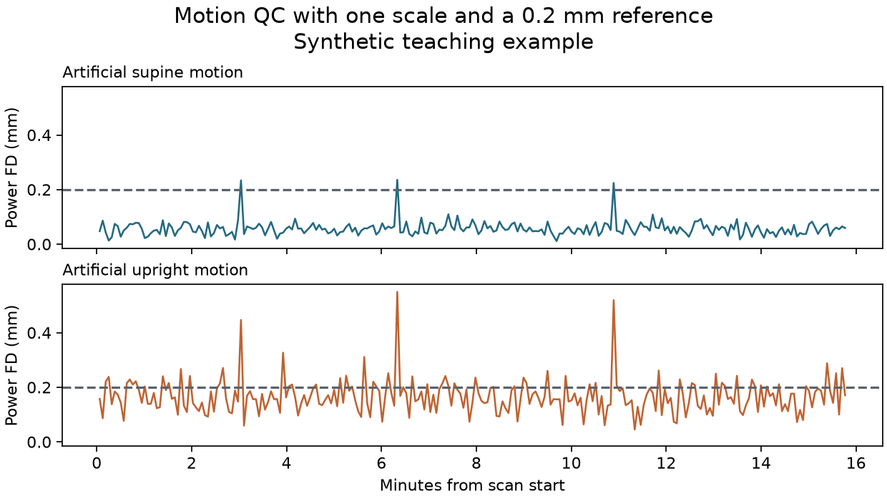
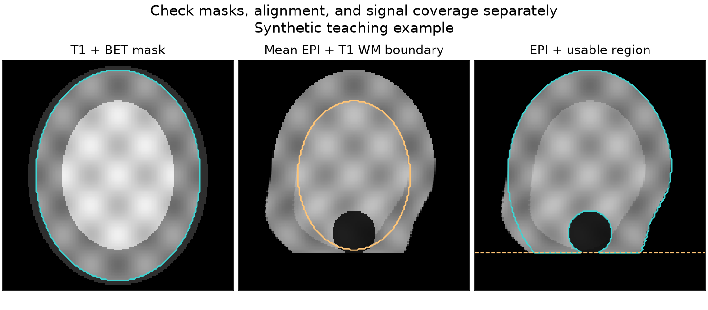
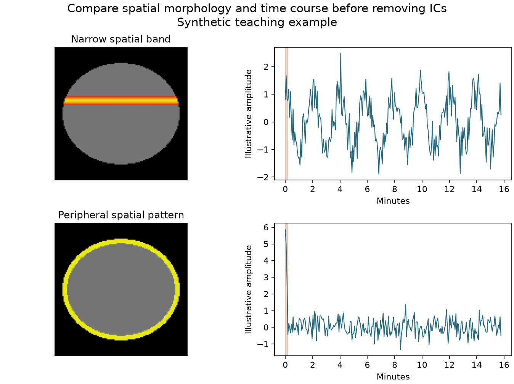
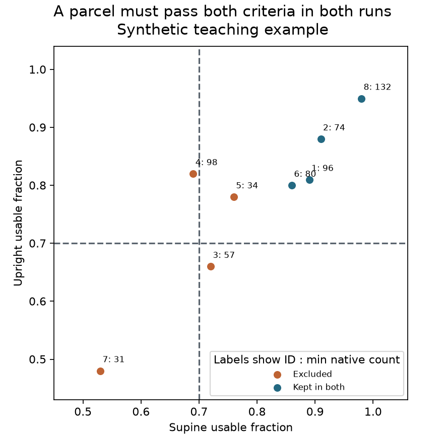
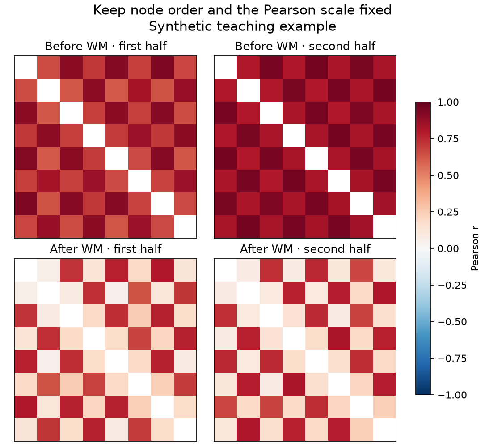

# FSL reproduction protocol for supine and upright resting-state fMRI

[中文版 ↓](#fsl-静息态-fmri-复现协议)

This public guide documents the workflow for a paired supine and upright resting-state fMRI pilot. It covers image inspection, motion correction, brain extraction, registration, single-session ICA, targeted artefact regression, parcel screening, and split-half functional connectivity. **The figures use synthetic inputs.** Exact reproduction of a project run requires authorised access to its original scans or archived intermediates.

## 1. Set up the software and inputs

The commands use Bash on Linux or Ubuntu under WSL 2. Install FSL and FSLeyes and set `FSLDIR` to the FSL installation. The scripts also need NumPy, SciPy, NiBabel, and Matplotlib. Run from the root of this repository. [FSL installation](https://fsl.fmrib.ox.ac.uk/fsl/docs/install/index.html) · [Windows and WSL](https://fsl.fmrib.ox.ac.uk/fsl/docs/install/windows.html)

```bash
export FSLDIR="$HOME/fsl"
python3 -m venv .venv
export PILOT_PYTHON="$PWD/.venv/bin/python"
"$PILOT_PYTHON" -m pip install numpy scipy nibabel matplotlib
"$PILOT_PYTHON" -m pip freeze > python-environment.txt
bash run.sh --help
"$PILOT_PYTHON" public_example.py --out /tmp/fsl-teaching-figures
```

The last command regenerates all five synthetic teaching figures without participant data. The project workflow also records the code revision, SHA-256 hashes of the inputs and scripts, tool versions, and per-stage logs. Key FSL components in the reference environment were BET2 2111.9, MCFLIRT 2111.0, FLIRT 2111.4, FAST4 2111.3, and MELODIC 2601.2. Matching versions helps when comparing numerical outputs. ICA component order may still vary.

Use a fresh working directory. Name one 3D T1 and one 4D BOLD NIfTI per posture as below. The pilot settings expect **250 BOLD volumes, TR 3.8 s, and 1.5 × 1.5 × 4.5 mm BOLD voxels**. Verify posture, anatomy, orientation, and TR against the acquisition record. Those checks matter because a plausible overlay can still compare the wrong images, and the TR determines the filter width.

```text
fsl-pilot-run/
├─ supine/
│  ├─ t1.nii.gz
│  └─ bold_raw.nii.gz
└─ upright/
   ├─ t1.nii.gz
   └─ bold_raw.nii.gz
```

```bash
WORK="$HOME/fsl-pilot-run"
# Put the four inputs in the locations shown above before running the checks.
bash run.sh check "$WORK"
cat "$WORK/qc/input_sha256.txt"
```

Readers without the study scans can use the FSL course data to practise visual inspection, registration, and single-session ICA. Use the course dataset's own volume count, TR, and acquisition parameters. The project runner is configured for the pilot above. [FSL course data](https://pages.fmrib.ox.ac.uk/fslcourse/website/index.html#Data) · [FSL ICA practical](https://pages.fmrib.ox.ac.uk/fslcourse/practicals/ica/index.html)

## 2. Check coverage and motion

The raw temporal mean makes acquisition boundaries and local low signal easier to see. MCFLIRT estimates within-run rigid-body motion and provides a motion-corrected mean for registration. Its six motion parameters also provide a timeline for assessing whether large signal changes coincide with movement. In Power FD, sum the absolute inter-volume translation differences and add the absolute rotation differences (radians) multiplied by a 50 mm radius. The first volume has undefined FD, so 250 volumes yield 249 valid transitions. The 0.2 mm line is a descriptive QC reference in this analysis. [MCFLIRT](https://fsl.fmrib.ox.ac.uk/fsl/docs/registration/mcflirt.html) · [Power FD](https://pmc.ncbi.nlm.nih.gov/articles/PMC3254728/)

```bash
bash run.sh motion "$WORK"
wc -l "$WORK"/{supine,upright}/mc.par
cat "$WORK/qc/motion.csv"
head -n 5 "$WORK/qc/upright_fd.tsv"
fsleyes "$WORK/supine/raw_mean.nii.gz" "$WORK/supine/mean.nii.gz" &
```

Check that each motion file has 250 rows and six columns, and that motion-corrected BOLD keeps 250 volumes. In FSLeyes, review the inferior boundary, the brain contour, and any local loss of signal. FD alone cannot establish image quality. The example below shows how to compare both traces on the same scale.



## 3. Extract the brain, register BOLD, and map the atlas

Three distinct questions guide the visual checks. **BET** asks whether the mask follows each image's own brain boundary. **BBR** asks whether the functional image aligns with the T1 white matter boundary. **Signal screening** asks whether a labelled location has enough usable signal. A region can fall inside the atlas and still be clipped or appear dark on mean EPI.

- **Brain extraction.** Apply `BET -f 0.37` to T1 and `BET -f 0.30` to the full motion-corrected EPI mean. These are pilot settings. Review the frontal and temporal edges, vertex and inferior cerebellum. The T1 mask supports registration and tissue segmentation. The separate EPI mask defines the native ICA region. [BET practical](https://pages.fmrib.ox.ac.uk/fslcourse/practicals/intro2/index.html)
- **BOLD to T1.** The supine route uses `epi_reg` on the original T1 grid. The upright route uses 1 mm isotropic T1, `BET -R` and FAST, then thresholds the WM partial-volume image at 0.5 for BBR. Keep continuous WM probabilities for the later sampling step. Overlay the registered mean and WM edge, and confirm plausible alignment within the acquired field of view. [Boundary-based registration](https://fsl.fmrib.ox.ac.uk/fsl/docs/registration/flirt/bbr.html)
- **T1 to MNI to native EPI.** Fit the T1 to the brain-extracted MNI152 2 mm template with a 12-DOF FLIRT affine. Bridge the supine native and 1 mm T1 grids using their headers, compose `T1_to_MNI @ BOLD_to_T1`, then invert it to move the Harvard–Oxford cortical atlas back to native BOLD. Nearest-neighbour interpolation preserves integer labels. Trilinear interpolation preserves continuous WM values. The 4D BOLD stays on its acquisition grid. [FLIRT guide](https://fsl.fmrib.ox.ac.uk/fsl/docs/registration/flirt/user_guide.html)

```bash
bash run.sh register "$WORK"
fsleyes "$WORK/supine/t1_brain.nii.gz" "$WORK/supine/bold_to_t1.nii.gz" \
  "$WORK/supine/bold_to_t1_fast_wmedge.nii.gz" &
fsleyes "$WORK/upright/mean.nii.gz" "$WORK/upright/atlas_native.nii.gz" &
fslinfo "$WORK/upright/atlas_native.nii.gz"
fslstats "$WORK/upright/wm_native.nii.gz" -R
```

The atlas and WM maps must occupy the native BOLD grid. If alignment looks wrong, check the pairing, brain masks, transform direction and target grid before extracting time series. The synthetic panel separates a mask boundary, an anatomical alignment problem and a missing-signal region.



## 4. Run ICA and review component candidates

For the startup sensitivity check, keep the full 250-volume supine run. For both primary ICA runs, drop original volumes 1–3 and retain 247. A **100 s high-pass** attenuates slow drift before decomposition. At TR 3.8 s this becomes the FSL sigma `100/(2 × 3.8) = 13.157895` volumes. In `fslmaths -bptf 13.157895 -1`, the `-1` disables the low-pass. The script restores the temporal mean, applies the explicit EPI mask with `--nobet` and uses automatic dimensionality in MELODIC.

```bash
bash run.sh ica "$WORK"
fsleyes --scene melodic -ad "$WORK/supine/trim3.ica" &
fsleyes --scene melodic -ad "$WORK/upright/trim3.ica" &
wc -l "$WORK"/supine/{initial,trim3}.ica/melodic_mix
```

Review **spatial maps, time series and spectra together**. A component concentrated on one native slice can indicate slice-specific artefact. A peripheral pattern can be checked against motion. Early temporal energy helps flag startup transients. Flag maps where one slice contributes over 50% of squared spatial loading for review. Match archived to new maps by absolute spatial correlation on a comparable mask and confirm the morphology. Each mixing matrix must have one row per retained volume and one column per component. Component IDs are 1-based and refer to that decomposition. [Manual ICA review guide](https://doi.org/10.1016/j.neuroimage.2016.12.036)



## 5. Regress the selected slice components and check the effect

The pilot tests the effect of removing **three reviewed single-slice components per posture**. The command uses the mixing matrix and mask from the same ICA as the 247-volume filtered BOLD. Save the selected IDs and justification with the run. Use your reviewed IDs when prompted.

```bash
read -r -p 'Supine IC IDs, comma-separated: ' SUPINE_ICS
read -r -p 'Upright IC IDs, comma-separated: ' UPRIGHT_ICS
bash run.sh denoise "$WORK" "$SUPINE_ICS" "$UPRIGHT_ICS"
cat "$WORK/qc/selected_ics.tsv"
fslval "$WORK/supine/clean.nii.gz" dim4
fslval "$WORK/upright/clean.nii.gz" dim4
```

After analysis, inspect `qc/slice_sd.csv` and the corresponding PNG. The script measures the temporal SD of the across-voxel median percentage signal. It erodes each slice mask, requires at least 100 candidate voxels, and uses voxel means above 10. A reduction concentrated in identified slices is the expected QC pattern. Broad changes prompt review of the selected ICs, their time series, and the brain mask. The raw-signal tissue check compares cortex, deep WM and outside-head background on shared slices to assess whether fluctuations are confined to one sample. It provides context for the WM sensitivity comparison.

## 6. Screen parcels and calculate split-half connectivity

A template label supplies an anatomical location. Sample a node only where there is usable signal. On each EPI grid, take the ICA brain mask and retain voxels at or above **25% of its median motion-corrected BOLD intensity**. Estimate each label's usable fraction against the full MNI atlas parcel, and take its native EPI voxel count separately. Keep parcels with **at least 70% estimated coverage and at least 50 usable native voxels** in each posture, then use the intersection and a fixed parcel order. These are operational pilot thresholds.



Extract the mean ICA-cleaned time course for every retained parcel. The WM sensitivity analysis fits one deep-WM nuisance regressor per node using all 247 volumes. Deep WM uses probability ≥ 0.95, distance ≥ 3 mm from the edge of the WM region defined at 0.80, and exclusion of accepted cortical labels. The supine route uses the raw tissue-sampling slice support. The upright route uses the eligible portion of native slices 6–22. Average within slices that have at least 50 usable WM voxels and weight those slices equally.

Use original volumes **4–126** in the first half and **128–250** in the second. Volume 127 is included in the whole-run nuisance fit. Each half contains 123 volumes. Calculate Pearson correlation matrices before and after adding the WM regressor. Compare matching edges in the strict upper triangle. Report median edge r, mean absolute edge differences, and edge-pattern agreement. These checks describe within-scan stability for a volunteer. A study-level posture comparison also needs an appropriate paired design and analysis. [FSLNets full correlation](https://fsl.fmrib.ox.ac.uk/fsl/docs/resting_state/fslnets.html)

```bash
bash run.sh analyse "$WORK"
bash run.sh figures "$WORK"
head -n 6 "$WORK/qc/parcels.csv"
cat "$WORK/qc/connectivity.csv"
ls "$WORK/qc/"*_{first,second}.csv
```



## 7. Validate and preserve the run record

| Check | Evidence |
| --- | --- |
| Correct inputs | Pairing, NIfTI orientation, 250 BOLD volumes, TR 3.8 s, hashes in `qc/input_sha256.txt` |
| Geometry | Reviewed BET, BBR and native atlas overlays, plus the recorded acquisition boundary |
| ICA and cleaned series | Exact run-specific component IDs, 247 rows in the trimmed mixing matrices, 247 cleaned volumes |
| Comparability | Same parcel names and order across conditions, 123 volumes per half, consistent WM fit and scale |
| Reproducibility | `logs/`, input hashes, `selected_ics.tsv`, `parcels.csv`, and result summaries in `qc/` |

With separately authorised historical derivatives, `bash run.sh replay NEW_WORK V1_ARCHIVE` links the archive inputs into a new workspace and regenerates numerical and visual QC. For the historical second-volunteer coverage follow-up, `bash run.sh coverage-replay NEW_WORK V2_ARCHIVE V1_PARCELS_CSV` compares the archived raw BOLD coverage against the first paired run. The scripts enumerate the expected input names. Run-local data, logs, and derived images belong in the authorised data workspace.

## 8. Extend coverage screening to a second pair

Use the full raw mean and BET for raw signal coverage. Use the raw mean after dropping the first three volumes for BBR. The historical rescue for a supine T1 used a reviewed BET centre and cropping before FAST. Those coordinates are specific to that image. For a new scan, determine the brain centre and crop from the actual T1, then map the WM mask back to the full structural grid. Apply the same 70% and 50-voxel gates to each scan. Check raw **geometric field of view** and **usable signal coverage** separately before intersecting nodes across all four scans.

## 9. Optional B0 distortion correction

The baseline uses the original EPI geometry. A separate field-map correction requires a field map matched to the scan and posture, its units and magnitude reference, the BOLD phase-encoding direction and polarity, and effective echo spacing or a documented effective total readout time. Phase-derived maps also need both echo times. Once verified, prepare the field map in rad/s, perform distortion-aware BBR, inspect corrected and baseline means in the same T1 view, then apply the verified warp to the whole 4D series. Verify atlas and WM maps on the resulting grid. Compare using matched eligibility and the same trimming and filter parameters. Signal dropout and out-of-field tissue remain part of QC. [BIDS field-map metadata](https://bids-specification.readthedocs.io/en/stable/modality-specific-files/magnetic-resonance-imaging-data.html#fieldmap-data) · [FSL epi_reg](https://fsl.fmrib.ox.ac.uk/fsl/docs/registration/epi_reg.html)

---

[↑ English](#fsl-reproduction-protocol-for-supine-and-upright-resting-state-fmri)

# FSL 静息态 fMRI 复现协议

本页是仰卧位与直立位静息态 fMRI 先导实验的公开复现指南。包含看图、头动、脑提取、配准、单次 ICA、成分回归、覆盖筛选和分半功能连接。**图中使用合成数据。** 精确复算项目数值需要获得原始扫描或存档中间文件的访问权限。

## 1. 配置软件并核对输入

在 Linux 或 Windows WSL 的 Ubuntu Bash 中安装 FSL 和 FSLeyes，配置 `FSLDIR`。Python 脚本使用 NumPy、SciPy、NiBabel、Matplotlib。从仓库根目录执行。[FSL 安装](https://fsl.fmrib.ox.ac.uk/fsl/docs/install/index.html) · [WSL 安装](https://fsl.fmrib.ox.ac.uk/fsl/docs/install/windows.html)

```bash
export FSLDIR="$HOME/fsl"
python3 -m venv .venv
export PILOT_PYTHON="$PWD/.venv/bin/python"
"$PILOT_PYTHON" -m pip install numpy scipy nibabel matplotlib
"$PILOT_PYTHON" -m pip freeze > python-environment.txt
bash run.sh --help
"$PILOT_PYTHON" public_example.py --out /tmp/fsl-teaching-figures
```

最后一条命令可以重新生成全部示意图。项目脚本记录代码版本、软件版本、输入与脚本的 SHA-256 和分阶段日志。原环境的主要 FSL 组件为 BET2 2111.9、MCFLIRT 2111.0、FLIRT 2111.4、FAST4 2111.3 和 MELODIC 2601.2。匹配版本有助于精确比较，重跑时仍应复核 ICA 编号。

两个体位各准备一份 3D T1 和一份 4D BOLD。先导扫描的 BOLD 为 **250 帧、TR 3.8 s、体素 1.5 × 1.5 × 4.5 mm**。先核对配对、空间方向和 TR。图像尺寸相同也可能配错结构像，TR 则会直接改变滤波参数。

```text
fsl-pilot-run/
├─ supine/
│  ├─ t1.nii.gz
│  └─ bold_raw.nii.gz
└─ upright/
   ├─ t1.nii.gz
   └─ bold_raw.nii.gz
```

```bash
WORK="$HOME/fsl-pilot-run"
# 放好上述四个 NIfTI，再运行检查。
bash run.sh check "$WORK"
cat "$WORK/qc/input_sha256.txt"
```

可以用 Oxford FSL 公开课程数据练习读图、配准和单次 ICA。课程数据使用自己的 TR、帧数和采集参数，仓库入口针对上面的先导实验配置。[FSL 课程数据](https://pages.fmrib.ox.ac.uk/fslcourse/website/index.html#Data) · [ICA 实操](https://pages.fmrib.ox.ac.uk/fslcourse/practicals/ica/index.html)

## 2. 看覆盖并处理头动

先看原始 BOLD 时均图，区分哪里没扫到、哪里扫到了但信号低。MCFLIRT 估计同一扫描内的刚体头动，生成用于配准的校正均值，并输出运动轨迹。Power FD 把相邻帧三轴平移绝对差与三轴旋转绝对差乘以 50 mm 后相加。250 帧提供 249 次有效转换，首帧 FD 未定义。本研究以 0.2 mm 作描述性质检参考线。[MCFLIRT](https://fsl.fmrib.ox.ac.uk/fsl/docs/registration/mcflirt.html) · [Power FD](https://pmc.ncbi.nlm.nih.gov/articles/PMC3254728/)

```bash
bash run.sh motion "$WORK"
wc -l "$WORK"/{supine,upright}/mc.par
cat "$WORK/qc/motion.csv"
head -n 5 "$WORK/qc/upright_fd.tsv"
fsleyes "$WORK/supine/raw_mean.nii.gz" "$WORK/supine/mean.nii.gz" &
```

确认每份 `mc.par` 有 250 行、6 列，校正后的影像保留 250 帧。用 FSLeyes 核对脑外缘、采集下边界和低信号区域，同时看两体位统一纵轴的 FD 曲线。


## 3. 脑提取、配准和图谱映射

质检分别回答三个问题：脑掩膜是否贴合底图，BOLD 是否与 T1 的白质边界对齐，以及图谱标签对应的地方是否有足够信号。

- **BET。** T1 用 `-f 0.37`，运动校正后的 EPI 均值用 `-f 0.30`。两者各用自己的网格，分别给结构配准分割和功能 ICA 提供脑范围。检查脑顶部、额颞边缘及小脑下部，再决定参数是否适合这次扫描。[BET 实操](https://pages.fmrib.ox.ac.uk/fslcourse/practicals/intro2/index.html)
- **BBR。** 仰卧位在原始 T1 网格用 `epi_reg`。直立位将 T1 重采样到 1 mm，运行 `BET -R` 和 FAST。用白质部分容积概率 ≥ 0.5 的二值掩膜配准，连续概率图留给后续白质采样。在已采到的区域检查平均 BOLD 是否沿白质边界对齐。[FSL BBR](https://fsl.fmrib.ox.ac.uk/fsl/docs/registration/flirt/bbr.html)
- **图谱回原生空间。** FLIRT 以 12 个自由度将 T1 对齐至 MNI152 2 mm 脑模板。仰卧位用头信息桥接原始和 1 mm T1 网格，组装 `T1_to_MNI @ BOLD_to_T1` 后求逆。Harvard–Oxford 皮层标签用最近邻，连续白质概率用三线性插值。4D BOLD 保留原生网格。[FLIRT 文档](https://fsl.fmrib.ox.ac.uk/fsl/docs/registration/flirt/user_guide.html)

```bash
bash run.sh register "$WORK"
fsleyes "$WORK/supine/t1_brain.nii.gz" "$WORK/supine/bold_to_t1.nii.gz" \
  "$WORK/supine/bold_to_t1_fast_wmedge.nii.gz" &
fsleyes "$WORK/upright/mean.nii.gz" "$WORK/upright/atlas_native.nii.gz" &
fslinfo "$WORK/upright/atlas_native.nii.gz"
fslstats "$WORK/upright/wm_native.nii.gz" -R
```

图谱与白质图的网格均应与 BOLD 一致。如果出现错位，先核对配对、掩膜、目标网格和变换方向。下图分开展示掩膜、白质边界、信号阈值和覆盖下边界。


## 4. 做 ICA 并人工复核

仰卧位保留完整 250 帧 ICA 作启动瞬变对照。两体位主分析都去掉最初 3 帧，剩 247 帧。**100 s 高通**减少缓慢漂移对空间分解的影响。按 TR 3.8 s，FSL 的 sigma 为 `100/(2 × 3.8) = 13.157895` 帧。`fslmaths -bptf 13.157895 -1` 中的 `-1` 关闭低通。脚本加回时均、使用 EPI 脑掩膜和 `--nobet`，MELODIC 自动估计成分数。

```bash
bash run.sh ica "$WORK"
fsleyes --scene melodic -ad "$WORK/supine/trim3.ica" &
fsleyes --scene melodic -ad "$WORK/upright/trim3.ica" &
wc -l "$WORK"/supine/{initial,trim3}.ica/melodic_mix
```

一起看**空间图、时间序列和频谱**。单层平方载荷超过 50% 的成分进入人工候选，结合形态确认。边缘模式可以对照头动，前 3 帧的时间能量可辅助判断启动瞬变。对照旧分解时用共同掩膜内的绝对空间相关做匹配。混合矩阵应当一帧一行、一成分一列。成分编号从 1 开始，对应这一次分解。[ICA 人工判读指南](https://doi.org/10.1016/j.neuroimage.2016.12.036)


## 5. 回归单层成分并检查效果

主分析每个体位回归**三个已确认的单层成分**。混合矩阵、掩膜和 247 帧高通 BOLD 来自同一轮 ICA。输入你实际确认的成分编号，在运行记录中保存切片位置和判读理由。

```bash
read -r -p '仰卧位确认的成分编号（逗号分隔）: ' SUPINE_ICS
read -r -p '直立位确认的成分编号（逗号分隔）: ' UPRIGHT_ICS
bash run.sh denoise "$WORK" "$SUPINE_ICS" "$UPRIGHT_ICS"
cat "$WORK/qc/selected_ics.tsv"
fslval "$WORK/supine/clean.nii.gz" dim4
fslval "$WORK/upright/clean.nii.gz" dim4
```

分析后检查 `qc/slice_sd.csv` 和图。脚本对掩膜逐层腐蚀，对至少有 100 个候选体素的切片，用均值大于 10 的体素计算百分比信号，取各帧的体素中位数再算时域 SD。目标切片降幅应与所选成分位置一致。如果全部切片都变化很大，复核编号与掩膜。组织采样另在相同切片内对照皮层、深部白质和头外背景，为白质回归敏感性比较提供线索。

## 6. 筛脑区并算分半连接

先在原生 BOLD 网格内将 ICA 脑掩膜与信号强度相交，保留运动校正后均值达到脑内中位数 **25%** 的体素。每个脑区的可用比例以完整 MNI 图谱脑区为分母，体素数则在原生空间计算。每个体位都要求**至少 70% 可用覆盖、至少 50 个原生体素**，再取两体位交集并统一脑区顺序。这是该先导分析用于筛选的工作阈值。


平均各脑区的 ICA 去噪信号。深部白质要求概率 ≥ 0.95，距离概率 ≥ 0.80 的区域边界至少 3 mm，并排除通过筛选的皮层标签。仰卧位沿用原始组织采样切片，直立位取原生第 6–22 切片的可用区域。每层至少有 50 个合格白质体素，逐层平均后等权合并。每个节点在整段 247 帧拟合一个白质回归系数。

分半矩阵用原始第 **4–126**、**128–250** 帧，各 123 帧。第 127 帧仍参与整段白质拟合。对照白质回归前后两组 Pearson 矩阵，取上三角边，报告边中位数、平均绝对差和两半的边模式相关。这些指标回答一次扫描内的稳定性。研究层面的体位差异还需要相应的配对设计和分析。[FSLNets 全相关](https://fsl.fmrib.ox.ac.uk/fsl/docs/resting_state/fslnets.html)

```bash
bash run.sh analyse "$WORK"
bash run.sh figures "$WORK"
head -n 6 "$WORK/qc/parcels.csv"
cat "$WORK/qc/connectivity.csv"
ls "$WORK/qc/"*_{first,second}.csv
```


## 7. 验收与存档复算

| 验收项 | 检查材料 |
| --- | --- |
| 输入 | 配对、方向、250 帧、TR 3.8 s，以及 `qc/input_sha256.txt` |
| 配准 | BET、BBR、原生图谱叠加及记录的采集下边界 |
| ICA 和回归 | 人工确认的成分号、247 行混合矩阵、247 帧去噪影像 |
| 分半对照 | 两半各 123 帧、同一脑区名和顺序、白质拟合及色标一致 |
| 运行记录 | `logs/`、`selected_ics.tsv`、`parcels.csv` 和质检汇总 |

已获得项目中间文件的读者可用 `bash run.sh replay NEW_WORK V1_ARCHIVE` 在新目录复算。后续两体位覆盖可用 `bash run.sh coverage-replay NEW_WORK V2_ARCHIVE V1_PARCELS_CSV` 对照第一对扫描。脚本中列出期望文件名。原始影像、运行日志和派生影像都放在获授权的研究数据空间。

## 8. 把覆盖筛选扩展到第二对扫描

用全程原始平均 BOLD 与 BET 筛信号覆盖，用去头 3 帧后的原始平均图跑 BBR。历史流程中曾重新定义仰卧位 T1 的 BET 中心，并裁剪后跑 FAST。新影像应在自己的 T1 上定位中心和裁剪范围，之后将白质掩膜映回完整结构网格。把每次扫描的**几何覆盖**和**可用信号比例**分别记录，再按相同的 70% 和 50 体素门槛取四次交集。

## 9. 可选的 B0 磁敏感畸变校正

基线保留原 EPI 几何。增加场图对照时，先确认场图对应的扫描和体位、物理单位、magnitude 参照、BOLD 的相位编码方向与极性，以及有效回波间隔或可追溯的有效总读出时间。由相位推场图还需要两个回波时间。准备 `rad/s` 场图后，用带场图的 BBR，在同一 T1 视图比较校正前后平均 BOLD。验收后把核对过的形变应用到整段 4D BOLD，更新或复核目标网格上的图谱和白质图。对照时使用相同裁剪、滤波和共同通过的脑区。缺失覆盖及完全掉信号的区域仍应标注。[BIDS 场图说明](https://bids-specification.readthedocs.io/en/stable/modality-specific-files/magnetic-resonance-imaging-data.html#fieldmap-data) · [FSL epi_reg](https://fsl.fmrib.ox.ac.uk/fsl/docs/registration/epi_reg.html)
